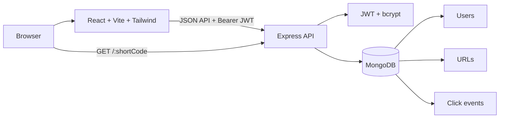

# Blink — URL shortener with analytics

Blink turns long URLs into memorable short links, then shows how those links are used. It is a full-stack learning project built to demonstrate API design, authentication, data modeling, redirect tracking, and a responsive React interface.

> **Project status:** Core link management, JWT authentication, click analytics, and the responsive dashboard are implemented. Redis caching, geolocation, anonymous links, and abuse moderation are intentionally out of scope for this first version.

## Features

- Secure signup and login with bcrypt-hashed passwords and short-lived JWT access tokens
- Cryptographically random, 7-character Base62 codes; optional custom aliases and availability checks
- HTTP 302 redirects, link expiry, disable/edit/delete controls
- Per-click timestamp, browser, device, and referrer analytics (raw IP addresses are not stored)
- Clicks-per-day, top-browser, and top-referrer dashboard analytics
- Copy-to-clipboard and downloadable SVG QR codes
- Zod request validation, URL checks, rate limits, Helmet headers, CORS allow-list, and consistent JSON errors
- Unit and Supertest integration tests

## Architecture



The browser sends authenticated management requests to Express. MongoDB is the source of truth for codes and link state. Redirect requests look up one code, record a click event, and return a temporary redirect. Redis is not enabled yet; adding it before measuring lookup latency would complicate invalidation when a link is edited, disabled, or expires.

## Code generation and redirects

The generator samples uniformly from Base62 (`0-9`, `A-Z`, `a-z`) using Node's cryptographic random source. Seven characters provide `62^7` (about 3.52 trillion) possible codes. Random codes don't expose creation order and do not require a separate sequence service. A unique MongoDB index is the final collision guard: generated codes retry up to five times; a duplicate custom alias returns `409 ALIAS_TAKEN`.

The service responds with **302 Found** rather than 301. Browsers and proxies may cache 301 responses for a long time. A 302 preserves the ability to edit or disable a destination and makes repeat clicks observable. The trade-off is that each visit reaches the service (and currently MongoDB) instead of being permanently cached by the browser.

## Data model and indexes

| Collection | Important fields                                                                  | Indexes                                      |
| ---------- | --------------------------------------------------------------------------------- | -------------------------------------------- |
| `users`    | `email` (normalized), `passwordHash`, timestamps                                  | Unique `email`                               |
| `urls`     | `owner`, `originalUrl`, `shortCode`, `isActive`, optional `expiresAt`, timestamps | Unique `shortCode`; `owner + createdAt DESC` |
| `clicks`   | `url`, `clickedAt`, `browser`, `device`, `referrer`                               | `url + clickedAt DESC`                       |

Click events are separate documents so a URL record stays small and analytics can query a time window. This version intentionally does not store raw IPs or country. There is no TTL retention policy yet; at larger scale, define a retention/aggregation policy before event volume grows without bound.

Redirect reads are expected to far outnumber link writes: a single link can be opened repeatedly by many recipients while it is created once. At higher traffic, put a CDN/load balancer in front of stateless API instances, cache short-code lookups in Redis with a short TTL, invalidate on edit/disable/delete, and keep MongoDB as the authority. Add read replicas for analytics and shard URL/click data based on measured access patterns. A Redis cache must never outlive a link's expiry or disabled state.

## Folder structure

```text
.
├── backend/
│   ├── src/
│   │   ├── config/       # Environment and MongoDB connection
│   │   ├── controllers/  # HTTP request handlers
│   │   ├── middleware/   # Auth, validation, and error handling
│   │   ├── models/       # Mongoose schemas and indexes
│   │   ├── routes/       # REST route definitions
│   │   ├── services/     # Link creation and analytics queries
│   │   ├── utils/        # Code generation, errors, URL checks
│   │   └── validation/   # Zod request schemas
│   └── test/             # Unit and API integration tests
├── frontend/
│   └── src/
│       ├── api/          # Axios service client
│       ├── components/   # Layout, forms, link card, QR dialog
│       ├── context/      # Authentication state
│       └── pages/        # Home, auth, dashboard, analytics
├── package.json          # npm workspaces and root scripts
└── README.md
```

## Requirements and local setup

- Node.js 20 or newer and npm
- MongoDB locally, or a MongoDB Atlas connection string

1. Copy `backend/.env.example` to `backend/.env` and set `MONGODB_URI` plus a random `JWT_SECRET` of at least 32 characters. Keep `.env` out of Git.
2. Copy `frontend/.env.example` to `frontend/.env` if the API is not at `http://localhost:4000/api`.
3. From the repository root:

   ```powershell
   npm install
   npm run dev
   ```

4. Open the Vite URL (usually `http://localhost:5173`), create an account, and make a link. The API listens on port `4000`.

### Environment variables

| Variable                | Service | Description                                                                                                    |
| ----------------------- | ------- | -------------------------------------------------------------------------------------------------------------- |
| `NODE_ENV`              | API     | `development`, `test`, or `production`                                                                         |
| `PORT`                  | API     | Express listen port; defaults to `4000`                                                                        |
| `MONGODB_URI`           | API     | MongoDB connection string                                                                                      |
| `JWT_SECRET`            | API     | Random signing secret, at least 32 characters                                                                  |
| `JWT_EXPIRES_IN`        | API     | Access-token lifetime, defaults to `15m`                                                                       |
| `CLIENT_URL`            | API     | Exact frontend origin allowed by CORS                                                                          |
| `PUBLIC_SHORT_URL_BASE` | API     | Public origin used to construct shareable links; in production this must route to the Express redirect service |
| `TRUST_PROXY`           | API     | Set `true` only when deployed behind a trusted proxy/load balancer                                             |
| `VITE_API_URL`          | Web     | API base URL including `/api`                                                                                  |

## API reference

All successful JSON responses use `{ "data": ... }`. Errors use `{ "error": { "code": "...", "message": "...", "details": ... } }`. Protected routes require `Authorization: Bearer <accessToken>`.

| Method   | Path                              | Auth | Request                                                              | Success                                                           |
| -------- | --------------------------------- | ---: | -------------------------------------------------------------------- | ----------------------------------------------------------------- |
| `POST`   | `/api/auth/register`              |   No | `{ "email", "password" }` (password: 10–72 chars)                    | `201` user and token; `409` duplicate email                       |
| `POST`   | `/api/auth/login`                 |   No | `{ "email", "password" }`                                            | `200` user and token; `401` invalid credentials                   |
| `GET`    | `/api/auth/me`                    |  Yes | —                                                                    | `200` current user                                                |
| `POST`   | `/api/urls`                       |  Yes | `{ "originalUrl", "customAlias"?, "expiresAt"? }`                    | `201` created link; `400` invalid input; `409` alias collision    |
| `GET`    | `/api/urls`                       |  Yes | —                                                                    | `200` caller's links with click totals                            |
| `GET`    | `/api/urls/check-alias?code=...`  |  Yes | Query alias                                                          | `200` `{ "available": boolean }`                                  |
| `GET`    | `/api/urls/:id/analytics?days=30` |  Yes | `days`: 1–90                                                         | `200` total, daily clicks, top browsers/referrers, recent events  |
| `PATCH`  | `/api/urls/:id`                   |  Yes | Any of `originalUrl`, `isActive`, `expiresAt` (`null` clears expiry) | `200` updated link; `404` not owned/not found                     |
| `DELETE` | `/api/urls/:id`                   |  Yes | —                                                                    | `204`; also deletes click events                                  |
| `GET`    | `/:shortCode`                     |   No | Short code in path                                                   | `302` `Location` to destination; `410` expired; `404` unavailable |
| `GET`    | `/health`                         |   No | —                                                                    | `200` `{ "status": "ok" }`                                        |

The API limits auth attempts, link-management traffic, and redirects by IP. URL validation accepts only HTTP(S), rejects embedded credentials, local/private literal destinations, and links back to the configured short-link host. These checks reduce common misuse; they are **not** a phishing or malware-detection service.

## Testing and quality checks

```powershell
npm test
npm run lint
npm run build
```

The backend tests use `mongodb-memory-server`; its first test run may need to download a MongoDB test binary.

## Deployment

1. Create a MongoDB Atlas database and restrict network access to the deployed API. Use a least-privilege database user.
2. Deploy the backend to Render or Railway from the repository root. Build/install with `npm ci`; start with `npm run start -w backend`. Configure all API variables from the table above. Set `NODE_ENV=production`, the frontend's exact HTTPS origin in `CLIENT_URL`, and your public short-link API origin in `PUBLIC_SHORT_URL_BASE`.
3. Deploy the Vite app to Vercel or Netlify from the repository root with build command `npm run build -w frontend` and output directory `frontend/dist`. Set `VITE_API_URL` to the deployed API's `/api` URL. The included root `vercel.json` supports React Router deep links on Vercel; on Netlify add a SPA rewrite to `/index.html`.
4. Use HTTPS for both services. Confirm the API health endpoint, register/login, create a link, follow a redirect, and verify analytics.
5. If using a custom short domain, point DNS and TLS at the redirect service and set `PUBLIC_SHORT_URL_BASE` to that domain. Do not set it to the frontend domain unless the frontend host is configured to proxy short-code paths to Express.

## Security notes and trade-offs

- Passwords use bcrypt with 12 rounds. JWT access tokens expire after 15 minutes. The demo keeps the token in `localStorage` for simplicity; a production application should evaluate Secure, HttpOnly, SameSite cookies and CSRF protections, plus refresh-token rotation.
- Express Helmet headers, strict JSON body size, CORS origin restriction, Zod validation, and rate limits form the baseline. Ownership checks are included on every link-management endpoint.
- React escapes rendered text by default; avoid injecting destination URLs as HTML. Destination URLs are rendered as ordinary text and redirects only allow HTTP(S).
- Private hostname resolution and real-time abuse/phishing feeds are deliberately not implemented. Since the API does not fetch destination URLs, this is not a server-side request-forgery filter; destination reputation and domain allow/deny workflows are future work.
- Rate limiting uses in-process memory by default. Multi-instance deployments should move limiter state to a shared store (such as Redis).

## Interview preparation

See [docs/interview-prep.md](./docs/interview-prep.md) for a two-minute project pitch, 20 sample interview questions, design trade-offs, and a timed live-demo script.

## Screenshots

Add screenshots of the home page, dashboard, and link analytics here after running the app.

## Suggested Git workflow

Use focused commits so each change is easy to review:

```text
chore: scaffold npm workspaces and project tooling
feat(api): add auth, URL management, and redirect analytics
feat(web): build responsive dashboard and link workflows
test: cover code generation, validation, and core API flows
docs: add setup, API, deployment, and interview guide
```

## Future improvements

- Redis redirect cache with safe invalidation and shared rate-limit storage
- Aggregated click rollups and configurable event retention
- Optional country lookup with explicit privacy disclosure
- Email verification, password reset, HttpOnly cookie sessions, and refresh-token rotation
- Domain reputation checks, abuse reports, and admin moderation
- Bulk CSV import, password-protected links, and dark mode
